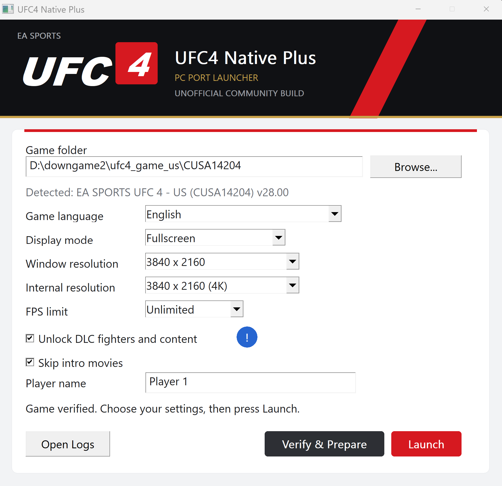
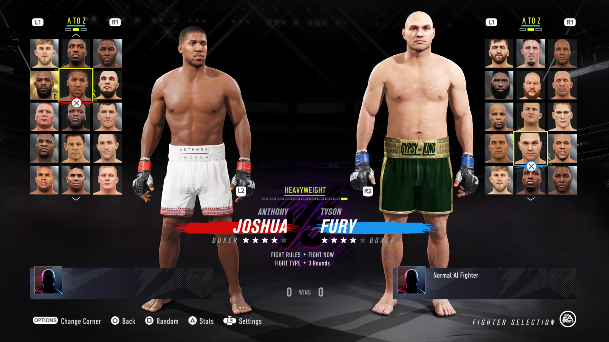
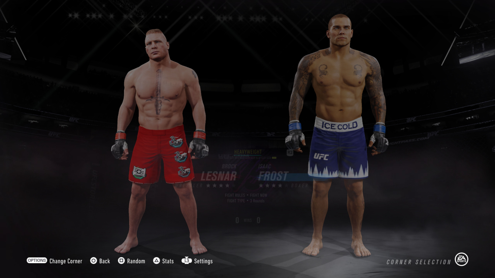
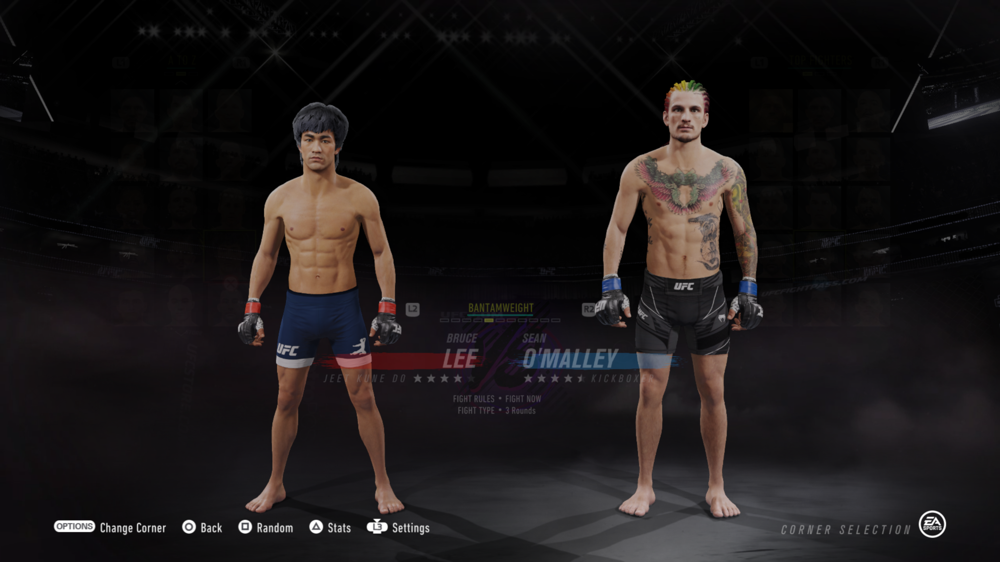
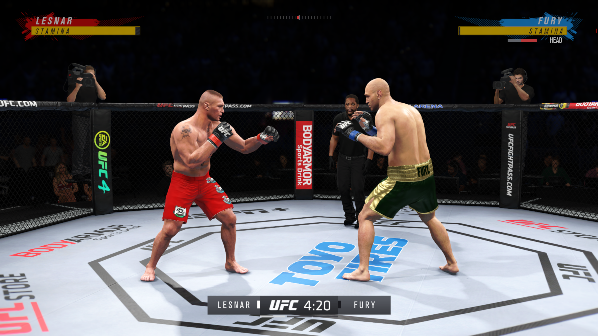

  
    

  
  

# UFC4 Native Plus

A community-maintained fork of [UFC4-PC-Port](https://github.com/schans-arg/UFC4-PC-Port), adding support for both the US and EU game editions, an optional DLC-related runtime patch, and a launcher for configuring the port.

This is an unofficial community project. It is not affiliated with, endorsed by, or sponsored by EA SPORTS, UFC, Sony, or PlayStation.

## What this fork adds

- **US and EU edition support:** extends the original port to support both editions.
- **Performance and stability improvements:** includes changes intended to improve performance and reduce crashes.
- **Optional DLC-related patch:** an optional patch applied to the port/runtime. It does not include or distribute DLC files or other game assets.
- **Launcher:** a dedicated interface for configuring supported port and launch settings.

Features and compatibility may vary by game edition, update, and configuration. Treat this project as experimental unless a release explicitly states otherwise.

### Stability notes

In the developer's own testing, no crashes were observed during the tested sessions. This is a limited personal test result, not a guarantee of crash-free operation; stability may vary depending on hardware, drivers, game files, settings, and play time.

## Screenshots

### Launcher

### Fighter selection

### Fighter roster

### Fighter comparison

### Gameplay

## Supported game editions

This fork targets the following EA SPORTS UFC 4 Title IDs and game update version:

| Edition | Title ID | Required update |
|---|---|---|
| US (North America) | `CUSA14204` | `v28.00` |
| EU (Europe) | `CUSA14209` | `v28.00` |

**Important:** The supported update version is `v28.00` for both editions. A matching Title ID with a different game update version is not the target configuration for this release and may not work correctly.

## Requirements

- A legally obtained copy of EA SPORTS UFC 4 that you have extracted yourself.
- The relevant game executable/entry file requested by the launcher or port.
- A Windows system that meets the requirements stated by the relevant release.

The game is not included. Users must supply their own game files.

## Game files and optional DLC patch

This repository does **not** include or distribute the game, game updates, DLC files, PlayStation firmware, save files, or other copyrighted game assets. You must provide your own extracted copy of the base game.

The optional DLC patch is included in the port and does **not** require downloading or installing separate DLC files. The base game files are sufficient for the patch's DLC-unlocking behavior. The patch changes how the port/runtime reports DLC availability; it does not contain the DLC assets themselves.

This technical description does not grant rights to DLC or other game content. Users are responsible for ensuring that their use complies with applicable law and the relevant platform/game terms.

Do not upload game dumps, extracted game content, DLC files, saves, or compiled game images to issues, pull requests, or releases.

## Installation and usage

1. Download the release archive from this fork's **Releases** page.
2. Extract the archive to a folder of your choice.
3. Launch the included launcher.
4. Select the location of your own extracted UFC 4 game files when prompted.
5. Configure the available options and start the port.

Exact steps and available settings may change between releases. Follow any release-specific instructions included with the download.

## Credits and upstream

This project is a fork of **[schans-arg/UFC4-PC-Port](https://github.com/schans-arg/UFC4-PC-Port)**. Credit goes to the original project author and contributors for their original work and the foundation this fork builds upon.

The upstream project itself incorporates components from **UFC3Native v0.1.5**. Those upstream components and their authors must continue to receive the notices and attribution required by their applicable licenses.

Changes specific to this fork include US/EU edition support, the optional DLC-related runtime patch, and the launcher. Please consult the commit history to distinguish upstream work from changes made in this fork.

## License and third-party notices

This fork retains the upstream license and applicable copyright notices for inherited code. The upstream runtime and integrated renderer are identified as GPL-2.0 in the upstream repository; see [`LICENSE`](LICENSE), [`THIRD_PARTY_NOTICES.md`](THIRD_PARTY_NOTICES.md), and file-level notices.

Third-party components may be governed by their own licenses. Their original license texts and notices must be preserved. Do not assume that every file in this repository has identical licensing terms; consult the relevant file-level and third-party notices before redistributing components.

Unless a file or component states otherwise, changes to GPL-licensed portions are distributed under the terms required by GPL-2.0. This source-code license does not grant rights to EA SPORTS UFC 4, its DLC, trademarks, or any other game assets.

## Disclaimer

EA SPORTS, UFC, PlayStation, and related names and marks belong to their respective owners. This is an unofficial community project and is not affiliated with or endorsed by those owners.

Use this software at your own risk. Compatibility is not guaranteed across all game editions, updates, hardware, or configurations.

## 🥊 Community & Support

Join the **Dynasty Team Discord** to stay updated on UFC4 Native Plus, get support, and report bugs.

**🔔 Updates & Announcements**

Head over to **#Update_UFC4-Native-Plus** for new releases, improvements, and project announcements.

**🛠️ Support & Bug Reports**

Visit **#Support_UFC4-Native-Plus** for troubleshooting, technical assistance, and bug reports.

**💬 Join the Community:** [Dynasty Team Discord](https://discord.gg/8qCwnGRpH)
