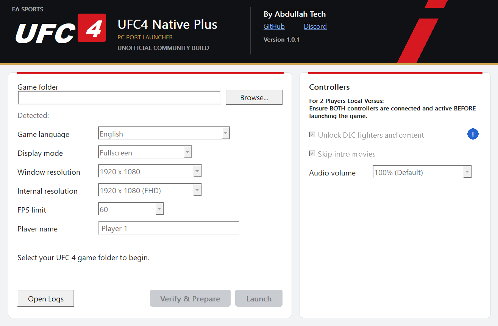
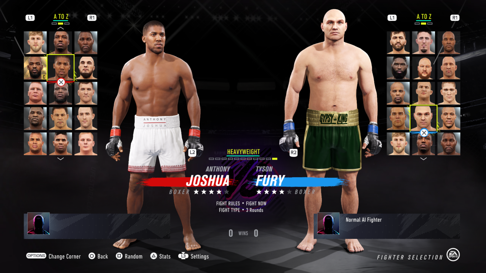
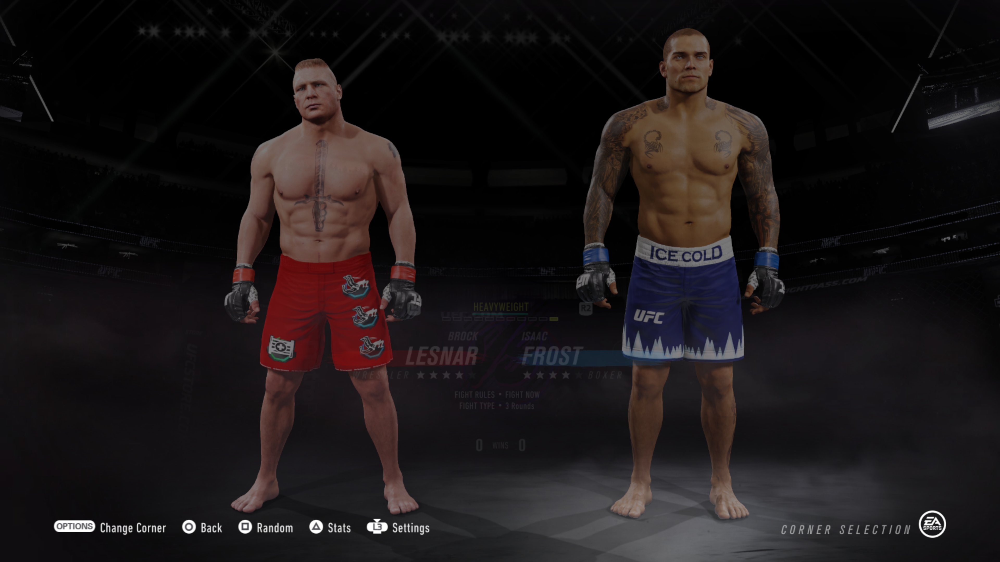
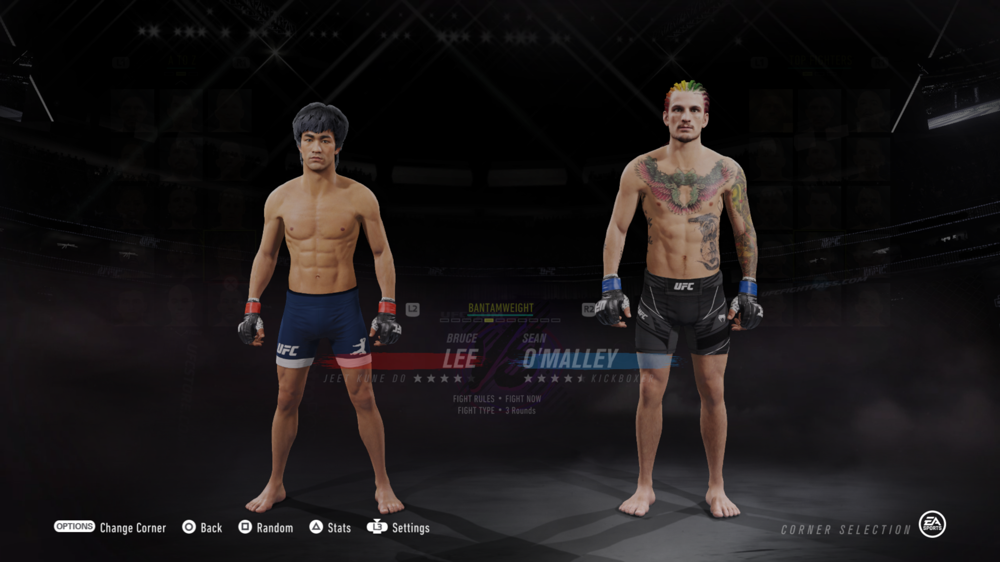
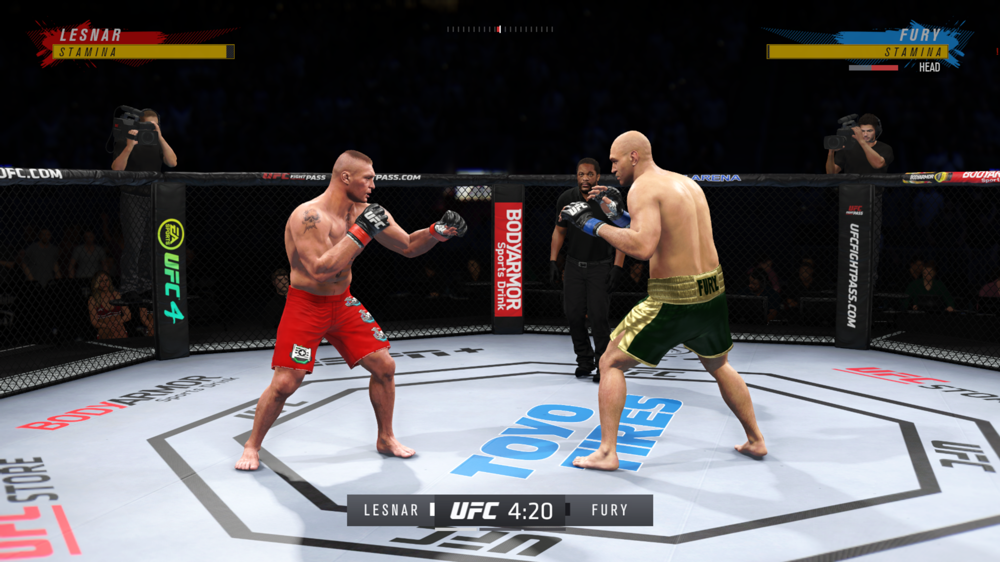

 

  
  
  
  

# UFC4 Native Plus

A community-maintained fork of [UFC4-PC-Port](https://github.com/schans-arg/UFC4-PC-Port), bringing EA SPORTS UFC 4 to Windows with support for both US and EU game editions, performance and stability improvements, an optional DLC-related runtime patch, and a dedicated launcher.

**Project Status: Stable / Playable**

UFC4 Native Plus reached its first stable release with v1.0.0. Subsequent updates continue to improve compatibility, performance, and stability.

This is an unofficial community project. It is not affiliated with, endorsed by, or sponsored by EA SPORTS, UFC, Sony, or PlayStation.

## Features

### Game Compatibility
- **US and EU Edition Support:** Supports both North American and European game editions.
- **Game Update v28.00:** Targets the supported v28.00 update for both editions.
- **DLC Fighters in Career Mode:** Use DLC fighters in Career Mode without requiring separate DLC files.
- **Two-Controller Support:** Play with two controllers.

### Performance & Graphics
- **Performance Optimizations:** Improved overall performance and smoother gameplay.
- **Frame Pacing Improvements:** Reduced stuttering and improved frame pacing during fights.
- **Smoother Animations:** Improved the smoothness of strikes, hit animations, and visual effects.
- **Memory Optimization:** Improved memory usage across different GPU and VRAM configurations.
- **Multiple Resolutions:** Support for 540p, 720p, 2K, and 4K resolutions.
- **PS4 Pro Resolution Handling:** Improved 2K and 4K support with automatic resolution handling in PS4 Pro mode.
- **Low-End Hardware Support:** Added 540p internal resolution and further memory optimizations for lower-end systems.

### Audio Improvements
- **Dialogue Boost:** Increased the center dialogue channel by +3 dB for clearer commentary, referee announcements, and fighter dialogue.
- **Adaptive Soft Limiter:** Helps reduce intense audio peaks and prevent digital distortion and clipping.
- **Audio Volume Control:** Adjust the audio volume directly from the launcher, with levels ranging from 75% to 200%.

### Stability & Fixes
- Fixed the Career Mode sparring issue.
- Fixed a crash that could occur when launching the game for the first time.
- Fixed crashes affecting some systems when selecting a fighter.
- Fixed freezing issues affecting some systems.
- Fixed various bugs and issues reported by the community.
- Improved overall runtime stability.

### Dedicated Launcher
- A dedicated launcher for configuring supported port settings.
- Audio volume control.
- Resolution and graphics configuration options.
- Convenient setup and launch workflow.

## Release

See the [Releases](https://github.com/abdullah-tech7/UFC4-Native-Plus/releases) page for downloads and complete release notes.

## Screenshots

### Launcher

### Fighter Selection

### Fighter Roster

### Fighter Comparison

### Gameplay

## Supported Game Editions

This project supports the following EA SPORTS UFC 4 Title IDs and game update version:

| Edition | Title ID | Required Update |
|---|---|---|
| US (North America) | `CUSA14204` | `v28.00` |
| EU (Europe) | `CUSA14209` | `v28.00` |

**Important:** Both editions require game update `v28.00`. Other update versions are not supported target configurations and may not work correctly.

## Requirements

- A legally obtained copy of EA SPORTS UFC 4 that you have extracted yourself.
- The relevant game executable/entry file requested by the launcher or port.
- A compatible Windows system.
- Hardware capable of running the selected resolution and graphics settings.

The game is not included. Users must supply their own game files.

## Game Files & Optional DLC Patch

This repository does **not** include or distribute the game, game updates, DLC files, PlayStation firmware, save files, or other copyrighted game assets.

You must provide your own extracted copy of the base game.

The optional DLC-related patch is included in the port and does **not** require downloading or installing separate DLC files. The base game files are sufficient for the patch's intended DLC-unlocking behavior.

The patch changes how the port/runtime reports DLC availability; it does not contain the DLC assets themselves.

This technical description does not grant rights to DLC or other game content. Users are responsible for ensuring that their use complies with applicable law and relevant platform/game terms.

Do not upload game dumps, extracted game content, DLC files, saves, or compiled game images to issues, pull requests, or releases.

## Installation & Usage

1. Download the latest release archive from the [Releases](https://github.com/abdullah-tech7/UFC4-Native-Plus/releases) page.
2. Extract the archive to a folder of your choice.
3. Launch the included launcher.
4. Select the location of your own extracted UFC 4 game files when prompted.
5. Configure the available options.
6. Start the port and enjoy UFC 4 on Windows.

Exact steps and available settings may change between releases. Follow any release-specific instructions included with the download.

### Updating from an Older Version

If you are updating from a previous version, transfer your save data to preserve your progress:

1. Open the `User` folder in your previous installation.
2. Locate the `SAVEDATA` folder.
3. Copy the entire `SAVEDATA` folder.
4. Paste it into the `User` folder of the new installation, maintaining the same folder structure.

Your save data should be located at:

`User/SAVEDATA`

**Important:** Back up your save data before updating. Failing to transfer the folder may result in losing your existing progress.

## Stability & Compatibility

UFC4 Native Plus reached its first stable release with v1.0.0 and is listed as **Playable** on Recompendium.

Subsequent releases continue to address reported issues and improve performance and compatibility.

Stability and performance may vary depending on hardware, GPU drivers, game files, resolution, and configuration. While extensive testing and community feedback have helped improve the project, individual system configurations may produce different results.

For the latest compatibility information and known issues, refer to the release notes and community support channels.

## Credits & Upstream

This project is a fork of **[schans-arg/UFC4-PC-Port](https://github.com/schans-arg/UFC4-PC-Port)**. Credit goes to the original project author and contributors for their original work and the foundation this fork builds upon.

The upstream project itself incorporates components from **UFC3Native v0.1.5**. Those upstream components and their authors must continue to receive the notices and attribution required by their applicable licenses.

Changes specific to this fork include:
- US and EU game edition support.
- Performance and stability improvements.
- Optional DLC-related runtime patch.
- Dedicated launcher.
- Career Mode DLC fighter support.
- Two-controller support.
- Audio improvements and dialogue boost.
- Additional resolution options and memory optimizations.
- Further fixes and improvements across releases.

Please consult the commit history to distinguish upstream work from changes made in this fork.

## License & Third-Party Notices

This fork retains the upstream license and applicable copyright notices for inherited code.

The upstream runtime and integrated renderer are identified as GPL-2.0 in the upstream repository. See:

- [LICENSE](LICENSE)
- [THIRD_PARTY_NOTICES.md](THIRD_PARTY_NOTICES.md)
- File-level license notices.

Third-party components may be governed by their own licenses. Their original license texts and notices must be preserved.

Do not assume that every file in this repository has identical licensing terms; consult the relevant file-level and third-party notices before redistributing components.

Unless a file or component states otherwise, changes to GPL-licensed portions are distributed under the terms required by GPL-2.0.

This source-code license does not grant rights to EA SPORTS UFC 4, its DLC, trademarks, or any other game assets.

## Disclaimer

EA SPORTS, UFC, PlayStation, and related names and marks belong to their respective owners.

This is an unofficial community project and is not affiliated with, endorsed by, or sponsored by those owners.

Use this software at your own risk. Compatibility is not guaranteed across all game editions, updates, hardware, or configurations.

## 🥊 Community & Support

Join the **Dynasty Team Discord** to stay updated on UFC4 Native Plus, get support, share feedback, and report bugs.

### 🔔 Updates & Announcements

Visit **#Update_UFC4-Native-Plus** for new releases, improvements, and project announcements.

### 🛠️ Support & Bug Reports

Visit **#Support_UFC4-Native-Plus** for troubleshooting, technical assistance, and bug reports.

### 💬 Join the Community

[Dynasty Team Discord](https://discord.gg/8qCwnGRpH)
